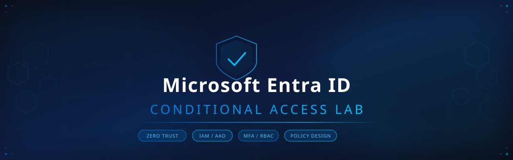

<div align="center">


</div>

---

## 📋 Project Overview

This project documents the **design, architecture, and implementation planning** of a Conditional Access policy framework using **Microsoft Entra ID** (formerly Azure Active Directory), following **Zero Trust** security principles.

A fully functional **Entra ID tenant** was provisioned with real user accounts, and a complete policy framework was designed covering MFA enforcement, geographic access restrictions, and privileged identity protection.

> **Note on Licensing:** Conditional Access policy enforcement requires Entra ID P1/P2. This lab documents policy design and configuration knowledge directly applicable to enterprise P1/P2 environments. All tenant infrastructure, user provisioning, and monitoring capabilities were implemented on the free tier.

---

## 🏗️ Environment Setup

| Component | Details |
|-----------|---------|
| **Tenant Name** | Default Directory |
| **Primary Domain** | `niazi199743gmail.onmicrosoft.com` |
| **License** | Microsoft Entra ID Free |
| **Admin Role** | Global Administrator |
| **Total Users** | 7 (including 2 dedicated test accounts) |
| **Groups** | 4 |
| **Applications** | 1 |

---

## 👥 Identity Infrastructure

Two dedicated test user accounts were provisioned to simulate real-world policy targets:

| User | UPN | Purpose |
|------|-----|---------|
| **Azan Khan** | `azan@niazi199743gmail.onmicrosoft.com` | Standard member — MFA policy testing |
| **Hassan Atif** | `hassan-atif@niazi199743gmail.onmicrosoft.com` | Standard member — Location policy testing |
| **Muhammad Ahmad** | Admin account | Global Administrator — Breakglass account |

> **Security Note:** In production environments, a dedicated **breakglass account** is always excluded from Conditional Access policies to prevent admin lockout — a critical Zero Trust design principle implemented here.

---

## 🔐 Conditional Access Policy Framework

### Policy 1 — Require MFA: All Users

```
Policy Name   : Require MFA - All Users
Target        : All users
Exclusions    : Global Administrator (breakglass)
Resources     : All cloud apps
Condition     : Any sign-in event
Control       : Require Multi-Factor Authentication
Deploy Mode   : Report-only → then Enforced
```

**Business Justification:**
The baseline Zero Trust principle — *"never trust, always verify"* — requires that every user authenticates with a second factor regardless of location or device. This policy eliminates credential-stuffing as a viable attack vector.

---

### Policy 2 — Block Access: Outside Allowed Countries

```
Policy Name   : Block - Outside Allowed Countries
Target        : All users
Exclusions    : Global Administrator (breakglass)
Resources     : All cloud apps
Condition     : Sign-in from location NOT in "Allowed Countries"
Named Location: Pakistan (trusted territory)
Control       : Block access
Deploy Mode   : Report-only → then Enforced
```

**Business Justification:**
Geographic restrictions reduce the attack surface from foreign threat actors. Combined with sign-in risk signals (available with P2), this policy stops the majority of credential-based attacks originating from high-risk regions.

---

### Policy 3 — Require MFA: Admin Roles

```
Policy Name   : Require MFA - Admin Roles
Target        : Directory Role → Global Administrator
Exclusions    : None (admins must always MFA)
Resources     : All cloud apps
Condition     : Any sign-in event
Control       : Require Multi-Factor Authentication
Deploy Mode   : Report-only → then Enforced
```

**Business Justification:**
Privileged accounts are the highest-value targets in any environment. Admin accounts with MFA have significantly higher resistance to takeover. This policy ensures no admin session can be initiated without a second factor — regardless of network or location.

---

## 📊 Monitoring & Audit Capabilities

The following monitoring surfaces were explored and are fully operational on the free tier:

### Sign-in Logs
Real-time visibility into every authentication event across the tenant — including timestamp, user, application, IP address, and Conditional Access policy status.

### Audit Logs
Complete audit trail of all directory changes: user creation, password updates, group modifications, application assignments, and authentication events. Evidence of user provisioning activity captured.

---

## 🗂️ Screenshots Walkthrough

| # | Screenshot | What It Shows |
|---|-----------|---------------|
| 01 | [All Users Overview](./screenshots/01-all-users-overview.png) | 7-user tenant including 2 dedicated test accounts |
| 02 | [Azan Khan — User Profile](./screenshots/02-test-user-azan-khan.png) | Test user provisioned for MFA policy simulation |
| 03 | [Hassan Atif — User Profile](./screenshots/03-test-user-hassan-atif.png) | Test user provisioned for location policy simulation |
| 04 | [Tenant Overview](./screenshots/04-tenant-overview.png) | Entra ID tenant with Global Admin access confirmed |
| 05 | [Conditional Access Overview](./screenshots/05-conditional-access-overview.png) | CA interface — policy conditions and controls documentation |
| 06 | [Named Locations](./screenshots/06-named-locations.png) | Named Locations blade — geographic boundary configuration |
| 07 | [Sign-in Logs](./screenshots/07-sign-in-logs.png) | Live authentication monitoring — admin sign-in events visible |
| 08 | [Audit Logs](./screenshots/08-audit-logs.png) | Full audit trail — user creation events confirmed |

---

## 📁 Repository Structure

```
entra-id-conditional-access-lab/
│
├── README.md                          ← You are here
├── banner.svg                         ← Project banner
│
├── docs/
│   ├── policy-design-document.md      ← Detailed policy specifications
│   └── zero-trust-framework.md        ← Zero Trust principles applied
│
└── screenshots/
    ├── 01-all-users-overview.png
    ├── 02-test-user-azan-khan.png
    ├── 03-test-user-hassan-atif.png
    ├── 04-tenant-overview.png
    ├── 05-conditional-access-overview.png
    ├── 06-named-locations.png
    ├── 07-sign-in-logs.png
    └── 08-audit-logs.png
```

---

## 🧠 Key Concepts Demonstrated

- **Zero Trust Architecture** — Never trust, always verify; least-privilege access
- **Conditional Access Policy Design** — Targeting, conditions, controls, and exclusions
- **MFA Enforcement Strategy** — Baseline vs. risk-based vs. role-based MFA
- **Named Locations** — Geographic trust boundaries in identity policy
- **Breakglass Account Design** — Admin exclusion patterns to prevent lockout
- **Report-only Mode** — Safe policy deployment methodology before enforcement
- **Sign-in & Audit Log Analysis** — Identity monitoring and threat detection
- **Tenant Administration** — User lifecycle management, provisioning, role assignment

---

## 🚀 Production Deployment Notes

In a production environment with **Entra ID P1/P2**, this framework would be extended with:

- **Sign-in Risk Policies** (P2) — Block or challenge risky sign-ins using Microsoft's threat intelligence
- **User Risk Policies** (P2) — Force password reset for compromised credentials
- **Device Compliance** (Intune) — Require managed/compliant devices for sensitive resources
- **Continuous Access Evaluation** — Real-time session revocation on threat detection
- **SIEM Integration** — Export sign-in and audit logs to Microsoft Sentinel for alerting

---

## 📚 References

- [Microsoft Entra ID Documentation](https://learn.microsoft.com/en-us/entra/identity/)
- [Conditional Access Overview](https://learn.microsoft.com/en-us/entra/identity/conditional-access/overview)
- [Zero Trust Deployment Guide](https://learn.microsoft.com/en-us/security/zero-trust/)
- [Named Locations Configuration](https://learn.microsoft.com/en-us/entra/identity/conditional-access/concept-assignment-network)
- [CA Policy Best Practices](https://learn.microsoft.com/en-us/entra/identity/conditional-access/plan-conditional-access)

---

## 👤 Author

**Muhammad Ahmad**
IAM & Identity Security | Microsoft Entra ID | Zero Trust

[](https://linkedin.com)
[](https://github.com)

---

<div align="center">
<sub>Part of the Microsoft Entra ID IAM Projects learning roadmap — Beginner to Advanced</sub>
</div>
